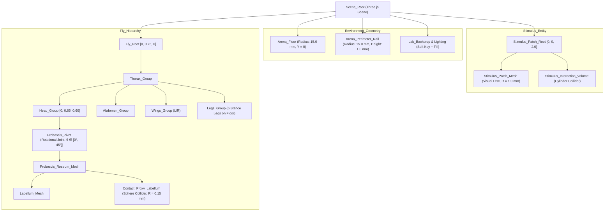
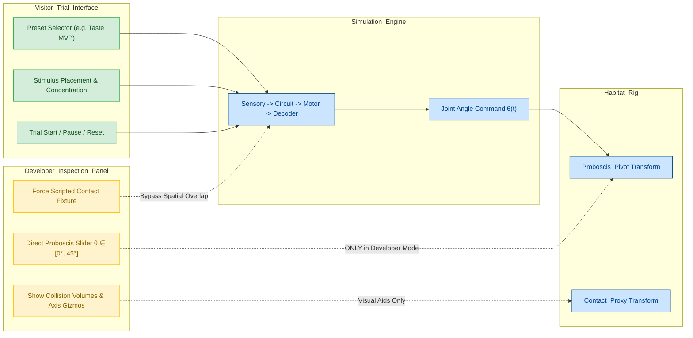

# NeuroFly Phase 2 Stage 2A: Habitat Scene Contract

**Document:** Stage 2A Handoff & Scene Implementation Contract  
**Phase:** 2 — Asset triage and Habitat greybox  
**Stage:** 2A — Handoff and scene contract  
**Active Repository Root:** `C:\Users\abhi0\Desktop\NeuroFly\NeuroFly`  
**Review Date:** 2026-11-14  
**Status:** Complete — Ready for Owner Review  

---

## 1. Purpose and Scope Boundaries

The purpose of this Scene Contract is to formalize the boundary between the Phase 1 sensorimotor specification and the Phase 2 3D Habitat implementation. It establishes the technical contracts, interface definitions, coordinate frames, and operational separation required to construct the initial NeuroFly Habitat greybox without conflating biological findings, engineering placeholders, or developer inspection tools.

### 1.1 Strict Project Boundaries
1. **Connectome & Neural Engine Exclusions:** Exact FlyWire FAFB v783 root IDs, synaptic weights, and biophysical neural integration remain Phase 3 and Phase 4 deliverables. No connectome subgraphs or neural simulation code are introduced in Phase 2.
2. **Causal Control Separation:** During an experimental trial, the visitor/user operates *only* the stimulus and trial parameters (e.g., placing the sucrose patch, altering concentration, triggering trial onset). Direct joint manipulation or fly piloting is strictly prohibited during scientific trials.
3. **Display vs. Interaction Separation:** The visual representation of the fly (mesh/geometry) is decoupled from the collision/contact proxies. Visual animations or procedural movements must never bypass or substitute for the underlying contact and motor state machines.
4. **Provisional Value Guardrails:** All spatial dimensions, stimulus concentrations, motor decoding thresholds, and kinematic angles specified herein are provisional engineering choices established to unblock 3D scaffolding. They must not be cited as biological measurements.

---

## 2. Repository State & Runtime Environment Audit

An inspection of the active repository root (`C:\Users\abhi0\Desktop\NeuroFly\NeuroFly`) on 2026-11-14 established the following ground-truth implementation baseline:

| Subsystem / Path | Inspected State on Disk | Implications & Implementation Boundary |
|---|---|---|
| **Frontend Root (`frontend/`)** | Contains only `.gitkeep`; no `package.json`, build configuration, or source files. | No web runtime currently exists. Stack proposal must be defined without premature dependency injection. |
| **Asset Trees (`assets/`)** | All subdirectories (`fly/`, `world/`, `textures/`, `ui/`, `audio/`, `calibration/`, `credits/`, `evaluation/`) contain only `.gitkeep`. | No 3D model (GLB/FBX), texture, or audio asset is present. Sourcing remains blocked pending licensing audit (Stage 2G). |
| **Body & Physics (`body/`)** | Contains only `.gitkeep`. | No joint solver, kinematic controller, or collision logic exists. |
| **Host Toolchain** | **Python 3.14.5** is installed and verified. **Node.js and npm are NOT installed** on the host environment (`CommandNotFoundException`). | Build scripts requiring `npm`/`npx` cannot be executed directly on the host without installing Node.js. Configuration and spatial contracts must be validated using machine-readable JSON and verified via Python tooling before frontend bundling. |
| **Version Control** | Git repository initialized; branch `master` tracking `origin/master`. | Clean working branch with untracked Phase 2 staging documents. |

### 2.1 Smallest Viable Implementation Location
To maintain architectural consistency with `docs/architecture.md` while accommodating the absence of a host Node.js runtime:
- **Central Scene Configuration:** Stored as machine-readable JSON in `scenarios/scene_config.json`. This serves as the single source of truth for both Python verification harnesses and future browser runtimes.
- **Verification & Spatial Math:** Implemented in `body/scene_coordinate_config.py` using standard Python 3.14 libraries (no external pip dependencies required).
- **Frontend Scaffolding:** Preserved in `frontend/` following the approved React + TypeScript + Vite + Three.js specification. When Node.js is provisioned by the environment owner, the frontend will consume `scenarios/scene_config.json` directly.

---

## 3. Habitat Scene Hierarchy & Entity Contracts

The Habitat scene graph is structured to cleanly separate static environment geometry, interactive stimulus objects, visual body parts, and invisible collision proxies.



### 3.1 Named Scene Entities
1. **`Arena_Floor`**: Circular ground disc centered at $(0, 0, 0)$, radius $R = 15.0\text{ mm}$, top surface at $Y = 0.0\text{ mm}$.
2. **`Arena_Perimeter_Rail`**: Visual boundary lip at radius $R = 15.0\text{ mm}$, height $H = 1.0\text{ mm}$.
3. **`Stimulus_Patch_Root`**: Anchor transform for the taste droplet/patch located at $(0.0, 0.0, 2.0\text{ mm})$.
   - `Stimulus_Patch_Mesh`: Visible disc, radius $1.0\text{ mm}$, thickness $0.05\text{ mm}$, color-coded by condition (sucrose = amber/translucent).
   - `Stimulus_Interaction_Volume`: Cylindrical bounding volume ($R = 1.0\text{ mm}, H = 0.1\text{ mm}$) centered at $(0.0, 0.05, 2.0\text{ mm})$.
4. **`Fly_Root`**: Base coordinate frame for the fly located at $(0.0, 0.75\text{ mm}, 0.0\text{ mm})$ in resting stance.
   - Facing direction: Oriented towards $+Z$ (anterior).
5. **`Proboscis_Pivot`**: Revolute joint positioned relative to `Fly_Root` at $(0.0, -0.30\text{ mm}, 0.70\text{ mm})$, giving a world resting position of $(0.0, 0.45\text{ mm}, 0.70\text{ mm})$.
   - Rotation axis: Transverse local $X$-axis.
   - Angular range: $\theta \in [0.0^\circ, 45.0^\circ]$, where $0.0^\circ$ is fully retracted and $45.0^\circ$ is full protraction/extension.
6. **`Contact_Proxy_Labellum`**: Invisible collision sphere rigidly bound to the distal tip of the proboscis hierarchy.
   - Geometry: Sphere of radius $r_{\text{contact}} = 0.15\text{ mm}$.
   - Resting position (at $\theta = 0.0^\circ$): $(0.0, 0.35\text{ mm}, 0.55\text{ mm})$ (retracted under head capsule; no contact).
   - Extended position (at $\theta = 45.0^\circ$): Moves along an arc to $(0.0, 0.05\text{ mm}, 1.15\text{ mm})$, bringing the sphere into positive intersection with `Stimulus_Interaction_Volume`.

---

## 4. Camera Systems & Presentation Viewports

The Habitat interface mandates four standard camera configurations to support both macro-scale trial observation and micro-scale contact inspection:

| Viewport Name | Target Focus Point $[X, Y, Z]$ | Camera Position $[X, Y, Z]$ | FOV | Primary Observational Role |
|---|---|---|---|---|
| **Overview Orbit (Default)** | $[0.0, 0.5, 0.75]\text{ mm}$ | $[0.0, 12.0, 18.0]\text{ mm}$ | $45^\circ$ | General spatial orientation showing fly, arena, and patch. |
| **Top-Down (Dorsal)** | $[0.0, 0.0, 1.0]\text{ mm}$ | $[0.0, 25.0, 1.0]\text{ mm}$ | $30^\circ$ | Symmetric alignment check, patch reachability, lateral stability. |
| **Lateral Profile (Sagittal)** | $[0.0, 0.5, 1.0]\text{ mm}$ | $[20.0, 0.5, 1.0]\text{ mm}$ | $30^\circ$ | Proboscis extension angle $\theta$, clearance above ground floor, contact descent. |
| **Macro Contact Close-Up** | $[0.0, 0.1, 1.15]\text{ mm}$ | $[1.5, 0.8, 2.6]\text{ mm}$ | $25^\circ$ | High-resolution inspection of labellum-patch intersection. |

---

## 5. Strict Separation of Visitor and Developer Controls

To preserve the scientific integrity of the simulation, control pathways are strictly bifurcated:



### 5.1 Visitor Scientific Trial Mode (Default)
- **Allowed Operations:**
  - Select scenario preset (`"taste_contact_proboscis_mvp"`).
  - Configure stimulus parameters ($C = 100\text{ mM}$ sucrose, water, or bitter caffeine).
  - Move/place the stimulus patch along the designated arena track ($Z \in [1.0, 3.0]\text{ mm}$).
  - Initiate trial, pause simulation, or trigger environment reset.
- **Forbidden Operations:**
  - Direct manipulation of the fly body, head, legs, or proboscis joint.
  - Manual forcing of motor neuron firing or proboscis protraction.
  - Manual assertion of contact without geometric collision.

### 5.2 Developer / Asset Inspection Mode (Isolated)
- **Visual Isolation:** Contained within a distinct collapsible drawer marked with a yellow high-visibility warning banner: `DEVELOPER ASSET INSPECTION ONLY — NOT A SCIENTIFIC TRIAL`.
- **Available Operations:**
  - Direct manual slider for proboscis angle $\theta \in [0.0^\circ, 45.0^\circ]$ to verify mesh deformation, pivot stability, and proxy tracking.
  - Visual toggles for collision wireframes: `Contact_Proxy_Labellum` (green sphere), `Stimulus_Interaction_Volume` (amber cylinder), and world axes gizmo.
  - Scripted contact override fixture to test downstream motor decoding independently of 3D geometry.
- **Safety Interlock:** Activating any developer inspection slider automatically pauses the scientific trial coordinator and flags the trial log as `PROVENANCE_DEVELOPER_OVERRIDE`, invalidating scientific scoring.

---

## 6. Dynamic Contact Event Specification

When running in dynamic 3D mode, the spatial engine performs geometric overlap queries on every frame between `Contact_Proxy_Labellum` and `Stimulus_Interaction_Volume`.

### 6.1 Event State Machine & Transition Rules
1. **Transition-Only Emission:** A contact event is emitted **if and only if** the discrete intersection state changes between frames ($t_{k-1}$ and $t_k$). Repeated `CONTACT_ON` events must NOT be generated while contact is sustained.
2. **Debouncing & Hysteresis:** Contact onset requires positive sphere-cylinder penetration depth $\delta \ge 0.001\text{ mm}$. Contact offset requires separation $\delta < -0.001\text{ mm}$.
3. **Reset Invalidation:** Resetting the trial immediately clears all active contact flags without emitting a false `CONTACT_OFF` event into the experiment log.

### 6.2 Standard Event Data Schema (JSON)
```json
{
  "event_id": "evt_20261114_001_0042",
  "event_type": "CONTACT_ON",
  "trial_time_ms": 112.4,
  "wall_clock_iso": "2026-11-14T00:25:00.123Z",
  "provenance": "DYNAMIC_HABITAT_GEOMETRY",
  "stimulus": {
    "entity_id": "Stimulus_Patch_Root",
    "condition": "sucrose_100mM",
    "nominal_concentration_mM": 100.0,
    "world_position_mm": [0.0, 0.0, 1.5]
  },
  "contact_proxy": {
    "proxy_id": "Contact_Proxy_Labellum",
    "radius_mm": 0.15,
    "world_position_mm": [0.0, 0.048, 1.498],
    "penetration_depth_mm": 0.004
  },
  "kinematic_state": {
    "proboscis_theta_deg": 44.2,
    "fly_root_position_mm": [0.0, 0.75, 0.0]
  }
}
```

---

## 7. Categorization of Values: Confirmed, Provisional, and Unresolved

To enforce scientific traceability, every parameter governed by this contract is categorized according to the evidence rules:

| Domain | Parameter / Feature | Value / Specification | Status | Epistemic Basis & Governance |
|---|---|---|:---:|---|
| **Assay Scope** | Primary Behavioral Vertical Slice | Taste contact to feeding proboscis extension response (PER) | **Confirmed** | Project charter & owner approval (2026-11-14). Approach locomotion excluded. |
| **Arena Geometry** | Arena Radius | $15.0\text{ mm}$ ($30.0\text{ mm}$ diameter) | **Provisional** | Engineering choice matching standard FlyWire/fly behavior arenas; adjustable in config. |
| **Arena Geometry** | Ground Surface Plane | Flat horizontal disc at $Y = 0.0\text{ mm}$ | **Confirmed** | Standard experimental ground reference. |
| **Stimulus Geometry** | Sucrose Patch Radius | $1.0\text{ mm}$ ($2.0\text{ mm}$ diameter) | **Provisional** | Engineering scale representative of a micro-droplet; uncalibrated. |
| **Stimulus Geometry** | Sucrose Patch Nominal Position | $[0.0, 0.0, 2.0\text{ mm}]$ | **Provisional** | Placed within reachable arc of extended proboscis from fly resting stance ($Z \in [1.0, 3.0\text{ mm}]$). |
| **Contact Geometry** | Labellar Sphere Proxy Radius | $0.15\text{ mm}$ ($0.30\text{ mm}$ diameter) | **Provisional** | Approximates adult female *D. melanogaster* labellum width (~$0.25\text{--}0.35\text{ mm}$); uncalibrated. |
| **Kinematic Range** | Proboscis Rostrum Protraction Angle ($\theta$) | $\theta \in [0.0^\circ, 45.0^\circ]$ | **Provisional** | Rotational approximation of rostrum protraction; uncalibrated against multi-segment anatomy. |
| **Kinematic Baseline** | Proboscis Resting Angle ($\theta_0$) | $0.0^\circ$ (retracted against head capsule) | **Provisional** | Standard resting configuration. |
| **Fly Body Scale** | Adult Drosophila Length Proxy | Total body length $\approx 2.5\text{ mm}$ | **Provisional** | Canonical biological mean ($2.0\text{--}3.0\text{ mm}$); visual placeholder. |
| **Circuit Mapping** | FAFB v783 Root IDs & Edges | Exact root IDs for sugar GRNs, SEZ interneurons, MN9 | **Unresolved** | Deferred to Phase 3. Strictly excluded from Phase 2. |
| **Hero 3D Asset** | Rigged Fly Model Licensing & Intake | etainproject CT-scan lead on Sketchfab | **Blocked / Unverified** | Unaudited redistribution rights. Procedural fallback mandated for Phase 2. |
| **Runtime Engine** | Browser Execution Stack | React + TypeScript + Vite + Three.js | **Proposed** | Awaiting Node.js environment provisioning by project owner. |

---

## 8. Stage 2A Completion Gate

Stage 2A is complete when:
- [x] Repository implementation baseline and toolchain constraints are audited and documented.
- [x] The smallest viable implementation boundary (`scenarios/scene_config.json` + `body/scene_coordinate_config.py`) is defined.
- [x] Scene entity naming and hierarchy are formally standardized.
- [x] Camera viewports and inspection points are established.
- [x] Scientific trial controls are strictly decoupled from developer posing tools.
- [x] Contact event state transition logic and JSON schema are specified.
- [x] All parameters are rigorously tagged as Confirmed, Provisional, or Unresolved.

*Proceed to Stage 2B upon generation of the evaluation packet.*
