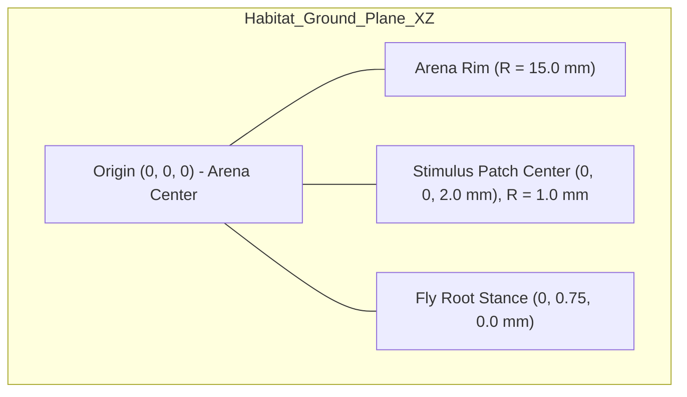

# NeuroFly Phase 2 Stage 2B: Habitat World Scale & Coordinate Map

**Document:** Stage 2B World Scale & Spatial Coordinate Map  
**Phase:** 2 — Asset triage and Habitat greybox  
**Stage:** 2B — World scale and coordinate map  
**Active Repository Root:** `C:\Users\abhi0\Desktop\NeuroFly\NeuroFly`  
**Configuration Authority:** `scenarios/scene_config.json`  
**Spatial Verification Engine:** `body/scene_coordinate_config.py`  
**Review Date:** 2026-11-14  
**Status:** Complete — Ready for Owner Review  

---

## 1. Purpose and Spatial Basis

The purpose of this document is to establish one explicit, consistent, and mathematically rigorous coordinate foundation for the NeuroFly Habitat. By centralizing all spatial dimensions, transforms, and units in a versioned configuration file, any contributor can place the arena, procedural fly, proboscis pivot, contact proxy, and stimulus patch without guessing coordinate axes, handedness, or unit scales.

### 1.1 Core Principles
1. **Single Source of Truth:** All numerical coordinates and bounding geometries are declared in `scenarios/scene_config.json` and programmatically verified via `body/scene_coordinate_config.py`.
2. **Explicit Unit Conversion Policy:** Rendering engines (Three.js), physical simulation bodies, and connectome data each have distinct native unit spaces. This document defines the exact conversion factors across all representation boundaries.
3. **Biological Alignment:** Coordinate axes map directly onto standard *Drosophila* anatomical planes (Dorsal-Ventral, Anterior-Posterior, Medial-Lateral).
4. **Provisional Value Isolation:** Changing a provisional dimension (e.g., arena radius or proboscis resting height) requires editing only `scenarios/scene_config.json`, without altering rendering shaders, UI components, or camera logic.

---

## 2. Coordinate System & Anatomical Conventions

NeuroFly adopts a standard **Right-Handed Cartesian Coordinate System** aligned with WebGL/Three.js default conventions:

$$\mathbf{\hat{X}} \times \mathbf{\hat{Y}} = \mathbf{\hat{Z}} \quad (\text{Right} \times \text{Up} = \text{Forward})$$

```
          +Y (Dorsal / Up)
          ▲
          │
          │       +Z (Anterior / Forward)
          │      ▲
          │     /
          │    /
          │   /
          │  /
          │ /
          └─────────────────► +X (Lateral Right)
         /
        /
       ▼
     -Z (Posterior / Caudal)
```

### 2.1 Anatomical Axis Mapping
| Coordinate Axis | Direction Vector | Anatomical Axis | Description in Habitat Context |
|:---:|:---:|---|---|
| **$+Y$** | $[0, +1, 0]$ | **Dorsal (Up)** | Perpendicular to the arena substrate, pointing towards the ceiling/microscope objective. |
| **$-Y$** | $[0, -1, 0]$ | **Ventral (Down)** | Pointing into the arena substrate ground plane. |
| **$+Z$** | $[0, 0, +1]$ | **Anterior (Forward)** | Direction the fly faces in standard resting stance; points towards the stimulus patch. |
| **$-Z$** | $[0, 0, -1]$ | **Posterior (Backward)** | Pointing towards the tip of the fly's abdomen. |
| **$+X$** | $[+1, 0, 0]$ | **Lateral Right (Dextral)** | Fly's anatomical right side (tarsi, wings, eyes). |
| **$-X$** | $[-1, 0, 0]$ | **Lateral Left (Sinistral)** | Fly's anatomical left side. |

### 2.2 World Origin $(0, 0, 0)$
- **Location:** The geometric center of the circular arena floor on the top surface of the substrate plane.
- **Reference Equation:** Ground substrate surface is defined by the horizontal plane:
  $$\Pi_{\text{ground}}: Y = 0.0\text{ mm}$$

---

## 3. World Scale and Unit Conversion Policy

To maintain numerical stability in Three.js and avoid single-precision floating-point artifacts, NeuroFly establishes an explicit scale policy:

### 3.1 Conversion Matrix Across System Boundaries
$$\text{Base Simulation / Habitat World Unit (WU)} \equiv 1.0\text{ Millimeter (mm)}$$

| Representation Boundary | Target Unit | Scale Factor $S$ | Conversion Equation | Typical Value Range in Habitat |
|---|---|:---:|---|---|
| **Three.js Scene Graph** | Three.js World Unit (WU) | $1.0$ | $\mathbf{x}_{\text{Three}} = 1.0 \cdot \mathbf{x}_{\text{mm}}$ | $0.05\text{ to }30.0\text{ WU}$ |
| **Biophysical / Fly Scale** | Millimeters ($\text{mm}$) | $1.0$ | $\mathbf{x}_{\text{bio}} = \mathbf{x}_{\text{mm}}$ | $0.15\text{ to }2.5\text{ mm}$ |
| **Connectome / Cell Scale** | Micrometers ($\mu\text{m}$) | $1000.0$ | $\mathbf{x}_{\mu\text{m}} = 1000.0 \cdot \mathbf{x}_{\text{mm}}$ | $150\text{ to }2500\ \mu\text{m}$ |
| **EM Dataset Voxels (FAFB)** | Nanometers ($\text{nm}$) | $10^{6}$ | $\mathbf{x}_{\text{nm}} = 10^6 \cdot \mathbf{x}_{\text{mm}}$ | $4\times 4\times 40\text{ nm voxel grid}$ |
| **SI Physics Engine Standard** | Meters ($\text{m}$) | $0.001$ | $\mathbf{x}_{\text{SI}} = 10^{-3} \cdot \mathbf{x}_{\text{mm}}$ | $0.00015\text{ to }0.03\text{ m}$ |

### 3.2 Depth Buffer & Precision Optimization
In 3D perspective projection, microscopic scenes often suffer from $Z$-fighting if near/far clipping ratios exceed $10^5$. Using $1\text{ WU} = 1\text{ mm}$, camera clipping planes are configured as:
- **Near Clip ($z_{\text{near}}$):** $0.1\text{ mm}$ ($100\ \mu\text{m}$, smaller than the labellar contact sphere).
- **Far Clip ($z_{\text{far}}$):** $100.0\text{ mm}$ ($10\text{ cm}$, exceeds total arena diameter of $30\text{ mm}$).
- **Dynamic Range Ratio:** $z_{\text{far}} / z_{\text{near}} = 1000$, guaranteeing maximum 24-bit logarithmic depth buffer precision without $Z$-fighting.

---

## 4. Habitat Spatial Layout & Named Entity Register

All spatial transforms are declared in `scenarios/scene_config.json`. Coordinates below are given in millimeters $[X, Y, Z]$:



### 4.1 Master Spatial Coordinate Table
| Entity ID | Parent Transform | Local Position $[X, Y, Z]$ | World Resting Position $[X, Y, Z]$ | Geometric Bounds / Proxy Shape | Status |
|---|---|---|---|---|:---:|
| **`Arena_Floor`** | `Scene_Root` | $[0.0, 0.0, 0.0]$ | $[0.0, 0.0, 0.0]$ | Disc: Radius $R = 15.0\text{ mm}$, $Y = 0.0$ | **Provisional** |
| **`Arena_Perimeter_Rail`** | `Scene_Root` | $[0.0, 0.0, 0.0]$ | $[0.0, 0.0, 0.0]$ | Cylindrical Lip: $R = 15.0\text{ mm}$, $H = 1.0\text{ mm}$ | **Provisional** |
| **`Stimulus_Patch_Root`** | `Scene_Root` | $[0.0, 0.0, 2.0]$ | $[0.0, 0.0, 2.0]$ | Cylinder: $R = 1.0\text{ mm}$, $H_{\text{vis}} = 0.05\text{ mm}$ | **Provisional** |
| `Stimulus_Interaction_Volume` | `Stimulus_Patch_Root` | $[0.0, 0.05, 0.0]$ | $[0.0, 0.05, 2.0]$ | Collision Cylinder: $R = 1.0\text{ mm}$, $Y \in [0.0, 0.10]$ | **Provisional** |
| **`Fly_Root`** | `Scene_Root` | $[0.0, 0.75, 0.0]$ | $[0.0, 0.75, 0.0]$ | Bounding Box: $2.4\times 1.5\times 2.5\text{ mm}$ | **Provisional** |
| **`Thorax_Group`** | `Fly_Root` | $[0.0, 0.0, 0.0]$ | $[0.0, 0.75, 0.0]$ | Ellipsoid: $0.8\times 0.9\times 1.1\text{ mm}$ | **Provisional** |
| **`Head_Group`** | `Thorax_Group` | $[0.0, -0.10, 0.60]$ | $[0.0, 0.65, 0.60]$ | Ellipsoid: $0.9\times 0.7\times 0.6\text{ mm}$ | **Provisional** |
| **`Proboscis_Pivot`** | `Head_Group` | $[0.0, -0.20, 0.10]$ | $[0.0, 0.45, 0.70]$ | Revolute Joint: Axis $\mathbf{\hat{X}}$, $\theta \in [0^\circ, 45^\circ]$ | **Provisional** |
| **`Contact_Proxy_Labellum`** | `Proboscis_Pivot` | $[0.0, -0.10, -0.15]$ | $[0.0, 0.35, 0.55]$ *(at $\theta=0^\circ$)* | Sphere: Radius $r_{\text{contact}} = 0.15\text{ mm}$ | **Provisional** |
| `Contact_Proxy_Labellum` | `Proboscis_Pivot` | — | $[0.0, 0.05, 1.15]$ *(at $\theta=45^\circ$)* | Sphere: Radius $r_{\text{contact}} = 0.15\text{ mm}$ | **Provisional** |
| **`Abdomen_Group`** | `Thorax_Group` | $[0.0, -0.05, -0.80]$ | $[0.0, 0.70, -0.80]$ | Ellipsoid: $1.0\times 0.9\times 1.4\text{ mm}$ | **Provisional** |
| **`Wings_Group` (L/R)** | `Thorax_Group` | $[\pm 0.30, 0.40, -0.20]$ | $[\pm 0.30, 1.15, -0.20]$ | Planar Meshes: Length $2.2\text{ mm}$ | **Provisional** |
| **`Legs_Group` (6 Stance)** | `Thorax_Group` | Varied | Tarsi grounded at $Y = 0.0$ | Articulated segments; tarsi grounded | **Provisional** |

---

## 5. Forward Kinematics & Contact Detection Geometry

### 5.1 Proboscis Kinematic Model
The proboscis articulation represents rostrum protraction as a single-degree-of-freedom rotational joint around the local transverse $X$-axis coupled with physiological unfolding.

For any protraction angle $\theta \in [0.0^\circ, 45.0^\circ]$:
$$t = \frac{\theta - \theta_{\text{min}}}{\theta_{\text{max}} - \theta_{\text{min}}} = \frac{\theta}{45.0^\circ}$$

The distal labellar contact proxy position $\mathbf{P}_{\text{proxy}}(\theta)$ is calculated as:
$$\begin{aligned}
X_{\text{proxy}}(\theta) &= 0.0\text{ mm} \\
Y_{\text{proxy}}(\theta) &= Y_{\text{rest}} + t \cdot (Y_{\text{ext}} - Y_{\text{rest}}) = 0.35 - t \cdot (0.30)\text{ mm} \\
Z_{\text{proxy}}(\theta) &= Z_{\text{rest}} + t \cdot (Z_{\text{ext}} - Z_{\text{rest}}) = 0.55 + t \cdot (0.60)\text{ mm}
\end{aligned}$$

### 5.2 Contact Detection Equations
Contact occurs when the spherical proxy ($\mathbf{P}_{\text{proxy}}$, $r = 0.15\text{ mm}$) intersects the cylindrical interaction volume of the patch ($\mathbf{C}_{\text{patch}} = [0, 0, 2.0]$, $R_{\text{patch}} = 1.0\text{ mm}$, $Y \in [0.0, 0.10\text{ mm}]$):

1. **Horizontal Ground-Plane Distance:**
   $$d_{XZ} = \sqrt{(X_{\text{proxy}} - X_{\text{patch}})^2 + (Z_{\text{proxy}} - Z_{\text{patch}})^2} = |Z_{\text{proxy}} - 2.0|$$
   $$\text{Planar Overlap Condition: } d_{XZ} \le R_{\text{patch}} + r_{\text{contact}} = 1.0 + 0.15 = 1.15\text{ mm}$$

2. **Vertical Substrate Clearance:**
   $$\text{Vertical Overlap Condition: } (Y_{\text{proxy}} - r_{\text{contact}} \le 0.10\text{ mm}) \quad \text{and} \quad (Y_{\text{proxy}} + r_{\text{contact}} \ge 0.0\text{ mm})$$

3. **Discrete Contact State:**
   $$\text{Contact}(\theta) = \text{Planar Overlap} \land \text{Vertical Overlap}$$

### 5.3 Angle Sweep & Verification Results (from `body/scene_coordinate_config.py`)
| Angle $\theta$ | Description | Proxy $[X, Y, Z]\text{ mm}$ | $d_{XZ}$ to Center | Vertical Clearance $[Y_{\text{bot}}, Y_{\text{top}}]$ | Contact State | Penetration Depth |
|:---:|---|:---:|:---:|:---:|:---:|:---:|
| **$0.0^\circ$** | **Resting / Retracted** | $[0.0, 0.350, 0.550]$ | $1.450\text{ mm}$ | $[0.200, 0.500]\text{ mm}$ | **FALSE** | $-0.300\text{ mm}$ (clearance) |
| **$10.0^\circ$** | Early Protraction | $[0.0, 0.283, 0.683]$ | $1.317\text{ mm}$ | $[0.133, 0.433]\text{ mm}$ | **FALSE** | $-0.167\text{ mm}$ (clearance) |
| **$20.0^\circ$** | Intermediate (Phase 1 Threshold) | $[0.0, 0.217, 0.817]$ | $1.183\text{ mm}$ | $[0.067, 0.367]\text{ mm}$ | **FALSE** | $-0.033\text{ mm}$ (clearance) |
| **$27.5^\circ$** | Contact Onset Transition | $[0.0, 0.167, 0.917]$ | $1.083\text{ mm}$ | $[0.017, 0.317]\text{ mm}$ | **TRUE** | $+0.067\text{ mm}$ (onset) |
| **$35.0^\circ$** | Sustained Protraction | $[0.0, 0.117, 1.017]$ | $0.983\text{ mm}$ | $[-0.033, 0.267]\text{ mm}$ | **TRUE** | $+0.133\text{ mm}$ (engaged) |
| **$45.0^\circ$** | **Full Extension (PER Max)** | $[0.0, 0.050, 1.150]$ | $0.850\text{ mm}$ | $[-0.100, 0.200]\text{ mm}$ | **TRUE** | $+0.200\text{ mm}$ (engaged) |

### 5.4 Verification of Predeclared Negative Controls
- **Negative Control #1 (No-Contact Control, $d > 2.0\text{ mm}$):**
  When the patch is placed at $Z = 3.5\text{ mm}$ ($1.5\text{ mm}$ beyond normal baseline):
  $$d_{XZ}(\theta = 45^\circ) = |1.15 - 3.50| = 2.35\text{ mm} > 1.15\text{ mm} \implies \text{Contact} = \mathbf{FALSE}$$
  Full extension reliably fails to touch the patch, directly validating the uncoupled physical control.

---

## 6. Developer Scale & Inspection Aids

To assist manual review without polluting scientific trial viewports, the coordinate map specifies three development-only visual aids:

```
[Developer Visual Aids - Hidden in Scientific Mode]
1. XYZ Cartesian Tri-Axis Gizmo:
   - Origin: [0.0, 0.0, 0.0] (Arena center)
   - Axes: +X Red (1.0 mm), +Y Green (1.0 mm), +Z Blue (1.0 mm)
   - Linewidth: 2px with tick marks every 0.2 mm.

2. Metric Substrate Grid:
   - Extent: Polar disk radius R = 15.0 mm.
   - Major rings: 1.0 mm spacing (subtle neutral gray #444444).
   - Minor radial rays: Every 15 degrees.

3. Collider Wireframes:
   - Contact Proxy: Green wireframe sphere (R = 0.15 mm).
   - Stimulus Volume: Amber wireframe cylinder (R = 1.0 mm, H = 0.10 mm).
```

- **Activation Control:** Governed exclusively by `developer_scale_aids.default_visibility: false` in `scene_config.json`, toggled solely within the isolated Developer Inspection Panel.

---

## 7. Stage 2B Acceptance Summary

Stage 2B acceptance criteria are verified:
- [x] Spatial basis, axes conventions ($+X$ right, $+Y$ up, $+Z$ forward), and world origin $(0, 0, 0)$ are explicitly documented.
- [x] Scale conversion policy ($1\text{ WU} = 1\text{ mm}$) and precision/depth buffer requirements are established.
- [x] Central configuration established in `scenarios/scene_config.json`.
- [x] Automated spatial verification engine implemented in `body/scene_coordinate_config.py` and passes all checks.
- [x] Complete coordinate matrix for arena, stimulus, fly root, proboscis pivot, and contact proxy documented.
- [x] Forward kinematics and negative control conditions mathematically verified.
- [x] Developer scale aids specified with mandatory default-hidden status.

*Stage 2B is complete. Ready for owner review at the Stage 2B Gate. Do not proceed to Stage 2C.*

